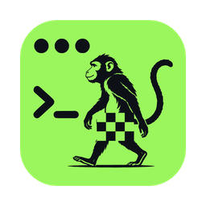

# naked — your session is still there

An SSH terminal that reattaches to your tmux session the moment the link comes back —
on macOS, Linux, iPhone and iPad.

- **The session survives the link.** Sessions live on the host's shared tmux socket, so a
  dropped Wi‑Fi, a sleeping laptop or a train tunnel only pauses the picture; an ordinary
  `ssh` from anywhere reaches the same session.
- **A terminal your thumb can drive.** esc, tab and ^C where a touchscreen needs them, and
  selection by touch.
- **The rest of a working day.** Saved hosts, tabs, splits, an SFTP browser, runbooks that
  show you the exact bytes before they run, and sessions that are still there after the app
  restarts.

Website: **https://naked-cli.cc**

## Download

**Current release: [0.1.0-beta.3](https://github.com/axelbaumlisto/naked/releases/tag/v0.1.0-beta.3)** — 12 Nov 2026

| Platform | Get it | Notes |
|---|---|---|
| macOS (Apple silicon, 12+) | `brew install axelbaumlisto/naked/naked` · [naked-0.1.0-beta.3-mac.dmg](https://github.com/axelbaumlisto/naked/releases/download/v0.1.0-beta.3/naked-0.1.0-beta.3-mac.dmg) | Signed with Developer ID and notarized by Apple. Update: `brew upgrade naked` |
| Linux x86_64 (Debian/Ubuntu) | [naked_0.1.0-beta.3_amd64.deb](https://github.com/axelbaumlisto/naked/releases/download/v0.1.0-beta.3/naked_0.1.0-beta.3_amd64.deb) | `sudo apt install ./naked_0.1.0-beta.3_amd64.deb` (needs `libwebkit2gtk-4.1-0`) |
| iPhone · iPad | [TestFlight](https://testflight.apple.com/join/Y1HaR5gj) | Beta |

Every release lists the SHA‑256 of its files in `SHA256SUMS`.

### All releases

| Version | Date | Files |
|---|---|---|
| [0.1.0-beta.3](https://github.com/axelbaumlisto/naked/releases/tag/v0.1.0-beta.3) | 2026-11-12 | [macOS .dmg (notarized)](https://github.com/axelbaumlisto/naked/releases/download/v0.1.0-beta.3/naked-0.1.0-beta.3-mac.dmg) · [Linux .deb](https://github.com/axelbaumlisto/naked/releases/download/v0.1.0-beta.3/naked_0.1.0-beta.3_amd64.deb) · [SHA256SUMS](https://github.com/axelbaumlisto/naked/releases/download/v0.1.0-beta.3/SHA256SUMS) |
| [0.1.0-beta.2](https://github.com/axelbaumlisto/naked/releases/tag/v0.1.0-beta.2) | 2026-11-11 | [macOS .dmg (notarized)](https://github.com/axelbaumlisto/naked/releases/download/v0.1.0-beta.2/naked-0.1.0-beta.2-mac.dmg) · [Linux .deb](https://github.com/axelbaumlisto/naked/releases/download/v0.1.0-beta.2/naked_0.1.0-beta.2_amd64.deb) · [SHA256SUMS](https://github.com/axelbaumlisto/naked/releases/download/v0.1.0-beta.2/SHA256SUMS) |
| [0.1.0-beta.1](https://github.com/axelbaumlisto/naked/releases/tag/v0.1.0-beta.1) | 2026-11-06 | [macOS .dmg (unsigned)](https://github.com/axelbaumlisto/naked/releases/download/v0.1.0-beta.1/naked_0.1.0-beta.1_aarch64.dmg) · [Linux .deb](https://github.com/axelbaumlisto/naked/releases/download/v0.1.0-beta.1/naked_0.1.0-beta.1_amd64.deb) · [SHA256SUMS](https://github.com/axelbaumlisto/naked/releases/download/v0.1.0-beta.1/SHA256SUMS) |

## Status

Beta. The desktop app is what its author works in every day; the tablet build is driven by
hand on a real device before anything ships.

## Source

The source code is not published yet — it will be once the app is out in the App Store.
This repository carries the release builds and the notices that go with them.

## Name, logo and licences

The name **naked** (as the name of a terminal / SSH client) and the logo are reserved by the
project owner. The third‑party components shipped inside the builds and their licences are
listed in [`THIRD-PARTY-NOTICES.md`](THIRD-PARTY-NOTICES.md).

Security issues: security@naked-cli.cc
